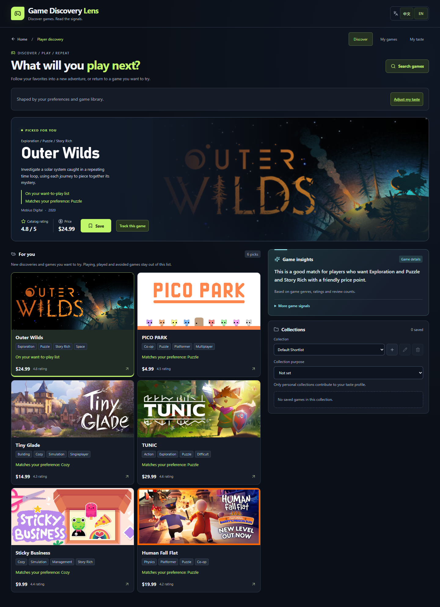
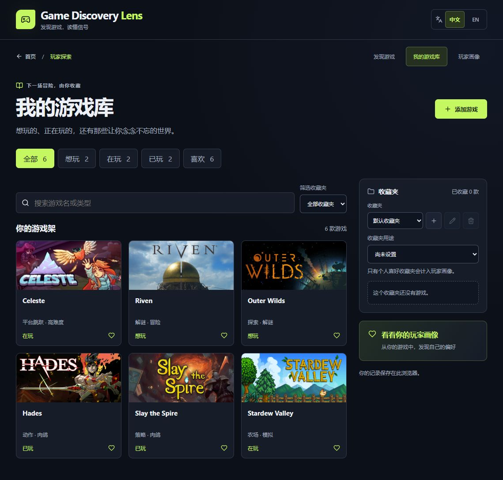

# Game Discovery Lens · 游戏棱镜

**From a Java database course project to a reliable bilingual web application.**

**从 Java 数据库课程项目，到注重可靠性的中英文 Web 应用。**

React · TypeScript · FastAPI · PostgreSQL · optional DeepSeek / 可选 DeepSeek

**Portfolio version — feature development frozen on 2026-11-16.**

**作品集版本——自 2026-11-16 起冻结功能开发。** 本项目用于展示重构、验证与问题处理能力，不继续扩展为正式商业产品。

[CI / 自动检查](https://github.com/ZedekiahS/Game-Discovery-Lens/actions) · [Case study / 工程案例](docs/case-study.md) · [Architecture / 架构](docs/architecture.md) · [Final verification / 收尾验证](docs/verification/portfolio-freeze-2026-11-16.md)

## Read in your language / 选择阅读语言

[中文](#gdl-zh) · [English](#gdl-en)

Click a language heading below to expand or collapse it **on this page**. English is open initially.

点击下方语言标题即可在**本页展开或收起**，无需打开另一个语言文件。英文默认展开；两种语言可以同时展开。

<a name="gdl-zh"></a>
<details>
<summary><strong>中文 — 项目背景、重构过程、仓库结构与运行方式</strong></summary>

## 这是什么项目

游戏棱镜是一个中英文游戏发现作品集应用，包含 80 款样例游戏。玩家可以发现游戏、搜索、建立收藏夹、记录想玩／在玩／已玩、表达喜好并保存笔记；玩家画像和首页推荐依据这些明确记录生成。开发者视角提供目录概览和作品对照。两个入口是浏览视角，不会授予不同的账号权限。

这不是实时商店或市场研究服务。目录价格、评分、评价数、拥有量和营收是已标识的合成演示值；玩法摘要和编辑标签另有来源与核对日期。应用内的中文／English 按钮可以直接切换界面语言并保留当前页面状态，与这里的 README 折叠阅读是两件事。

## 原来怎么做，后来怎么改

项目起点是 **Java Swing + SQL Server 的小组课程作业**，包含玩家／开发者界面、游戏数据、购买、评论、礼包和代金券等数据库业务。后续曾以 ArcadeIQ 整理为作品集，现名 Game Discovery Lens；历史资料中的 GameSniper、GameRate 和 ArcadeIQ 名称保留其当时语境。

现代版沿用游戏领域和部分业务概念，重新实现了浏览器前端、HTTP API 与 PostgreSQL 数据模型。它独立运行，既不是简单改名，也不是将旧 Java 代码逐行自动翻译成网页。旧功能没有全部迁入现代版。

| 方面 | 原课程实现（保留的历史代码） | 现代作品集实现 |
| --- | --- | --- |
| 页面与调用 | Java Swing 窗口，经 JDBC 调用数据库和存储过程 | React/TypeScript 页面，经服务适配器调用 FastAPI；另有不依赖后端的浏览器体验模式 |
| 数据库 | SQL Server 表、视图、SQL 迁移和存储过程 | PostgreSQL、SQLAlchemy 与 Alembic 迁移；不是旧学校数据库的在线搬迁 |
| 产品范围 | 游戏数据库／市场交易类课程业务 | 聚焦发现、搜索、个人收藏、游玩记录、笔记、偏好与研究参考 |
| 私人数据边界 | 桌面服务连接数据库，业务逻辑分布在 Java 与 SQL 中 | 后端从 bearer token 确定 owner；旧账号响应、跨标签会话和私人草稿分别隔离 |
| 搜索与推荐 | Java 界面和数据库查询 | 中英文有限规则搜索、可编辑条件、URL 恢复；推荐由明确记录推导；可选模型只解释查询 |
| 保存与并发 | 原有课程业务及数据库过程 | 记录／偏好条件写入，拒绝陈旧覆盖；保留草稿，未知写入结果先读取核对，不自动重放 |
| 交付验证 | 历史启动脚本、导入工具和课程资料 | 单元/UI 测试、隔离 PostgreSQL 集成测试、真实 API 浏览器流程、Docker 构建产物验证与 Computer Use |

**实际改造顺序：**整理并保留旧实现 → 建立现代 Web 页面与 API → 补账号所有权、收藏与个人记录 → 统一搜索、标签语义和来源说明 → 完善状态恢复、并发保护与缓存 → 验证真实构建产物 → 修复注册点击问题并完成文档收尾。各阶段的错误、修正和证据保留在 [工程案例](docs/case-study.md)、[迁移状态](docs/migration-plan.md) 与 `docs/verification/`，不是每个阶段都只做了“重命名”。

## 作者范围与 AI 的作用

原课程部分是**小组成果**，归属原项目团队。作品集展示重点是维护者在其后的个人重构阶段主导需求、范围取舍、技术方案与验收，使用 Codex 等 AI 编码工具辅助分析、实现、测试、排错和文档，并通过可重复检查与交互复核核对结果。维护者对工程决策、变更复核、验证及最终交付负责；现代实现包含 AI 辅助编写的代码与测试。

**AI 辅助开发**与**程序中的 AI 功能**不同：前者是上述开发方法；后者是可选 DeepSeek 搜索解释器，将自然语言转成受约束的查询条件，再由应用执行数据库查询。模型不直接执行 SQL、不修改私人记录，也不是所有推荐和洞察的来源。规则回退有明确来源标识。没有密钥也能体验并运行自动测试。

## 仓库怎么读

| 路径 | 用途 |
| --- | --- |
| `frontend/` | 当前 React/TypeScript 应用、UI、领域 hooks、API/demo 适配器及浏览器测试 |
| `backend/` | 当前 FastAPI、认证与业务接口、SQLAlchemy 模型、测试；**`backend/alembic/` 是现代数据库迁移** |
| `catalog/` | 前后端共用的 80 款样例目录与标签族约定 |
| `tests/fixtures/` | 跨语言搜索合同与推荐诊断场景；不是实际玩家行为数据 |
| `scripts/`、`.github/workflows/` | 启动与交付验证脚本、四项 CI 检查 |
| `docs/` | 架构、工程案例、运行指南、验证记录和截图 |
| `UI/`、根目录 `migrations/`、`Views/` | **旧 Java Swing / SQL Server 历史实现**；不是现代应用运行依赖 |
| `PopulationScripts/`、`WebScrape/`、`data/` | 旧数据导入、抓取工具及数据文件；现代目录不在启动时联网抓取 |
| `demo/` | 较早的静态原型；当前体验入口是 `frontend/` 的 `?mode=demo` |
| `ER.vsdx` | 旧数据库设计资料，不代表现代 PostgreSQL 的完整模型 |

现代 API 路径：浏览器页面 → hooks/服务适配器 → FastAPI → PostgreSQL。画像／推荐是基于已确认数据的纯函数；应用没有微服务、任务队列或向量检索。Compose 的 PostgreSQL 镜像名称包含 pgvector，不代表实现了向量搜索。详见 [架构说明](docs/architecture.md)。

## 怎样运行

**最快体验：**安装 Node.js 24（版本见 `.nvmrc`），从仓库根目录运行：

```powershell
cd frontend
npm ci
npm run dev -- --host 127.0.0.1 --port 5173
```

打开 [浏览器体验模式](http://127.0.0.1:5173/?mode=demo)。无需 Java、数据库或 AI 密钥。收藏、记录和偏好只保存在当前浏览器，不是服务端账号数据。

**真实账号与持久化：**保持前端运行，在另一个终端回到仓库根目录。安装并启动 Docker 后：

```powershell
docker compose up -d --build postgres backend
docker compose exec backend alembic upgrade head
docker compose exec backend python -m app.scripts.seed
```

这些是新本地环境的初始化步骤。打开 [API 模式](http://127.0.0.1:5173/?mode=api)，注册或登录后保存到 PostgreSQL。Compose 只启动这里指定的 PostgreSQL 和后端；前端独立运行，SQL Server 是可选历史复现。不要用默认本地口令公开部署。

已有安装更新时先备份需要保留的数据，执行迁移并刷新旧页面；迁移 `0006` 保留偏好。不要为了升级重新导入 seed：seed 是样例目录初始化／更新工具，不是迁移用户数据的方法。原生 Python 启动和配置细节见 [后端指南](backend/README.md)；前端生产构建、API 地址与语言规则见 [前端指南](frontend/README.md)。后端配置放根目录 `.env`，前端配置放 `frontend/.env.local`；AI 密钥只能放后端，不能放 `VITE_*`。

## 可靠性证据与停止边界

账号所有权、版本冲突、跨标签切换、慢响应、断网和已提交但丢失响应都有对应验证。测试使用隔离 schema 或一次性数据库，不清空主库；CI 包括后端、前端测试与构建、真实 API 浏览器流程，以及实际 Docker 镜像＋前端产物流程。完整命令在本页末尾 [Verification](#verification)。最终结果见 [收尾记录](docs/verification/portfolio-freeze-2026-11-16.md)；前一轮的 [123/310/38 项及构建产物证据](docs/verification/delivery-preferences-search-2026-11-15.md)保留原时间，不冒充本轮新跑的数量。

本版本冻结功能开发，不再执行推荐质量、公开评论、支付、SSO、市场数据采集或生产运营路线图。保留这些限制：80 款样例目录；有限语言解析；未接入评论原文；推荐评测是固定编写的诊断场景，不是真实用户准确率；私人草稿仅在当前标签页内存中恢复，关闭／重载页面后不会持久保留；移动验证使用浏览器窄视口，不等于实体手机覆盖。旧版本的未来工作段落是历史背景，不是当前待办。

</details>

<a name="gdl-en"></a>
<details open>
<summary><strong>English — background, refactoring, repository layout and setup</strong></summary>

## What this project demonstrates

Game Discovery Lens is a bilingual game-discovery portfolio application with an 80-game sample catalog. Players can search, collect games, record Want to play / Playing / Played, express preferences and keep notes. Taste profiles and homepage recommendations derive from those explicit records. The developer perspective provides catalog summaries and comparison references. Perspectives do not grant account permissions.

This is not a live store or market-research service. Prices, ratings, review counts, ownership and revenue are labelled synthetic values. Gameplay summaries and editorial tags have separate sources/check dates. The app's Chinese/English control changes its interface in place while retaining page state; the README uses the language disclosures above.

## Before and after

The starting point was **group coursework using Java Swing and SQL Server**, with player/developer windows, game data and database workflows for purchases, reviews, bundles and vouchers. It was later presented as ArcadeIQ and renamed Game Discovery Lens. Historical GameSniper, GameRate and ArcadeIQ names retain their original context.

The modern version carries forward the game domain and selected business concepts, with a new browser frontend, HTTP API and PostgreSQL model. It runs independently of the school database. This was a scoped reimplementation and refactor, not just a rename or a line-by-line automatic Java conversion; not every legacy feature was carried over.

| Area | Retained coursework implementation | Modern portfolio implementation |
| --- | --- | --- |
| UI and calls | Java Swing windows; JDBC calls to the database/stored procedures | React/TypeScript pages and service adapters calling FastAPI; an independent browser-only mode |
| Storage | SQL Server tables, views, SQL migrations and stored procedures | PostgreSQL, SQLAlchemy and Alembic; no live transfer of the school database |
| Scope | Game database and marketplace coursework workflows | Discovery, search, collections, play records, notes, preferences and research references |
| Private data | Desktop services connect to the DB; business logic spans Java and SQL | Server-side bearer ownership, verified sessions, stale-response guards and account-scoped drafts |
| Search and recommendations | Java forms and database queries | Bounded bilingual parsing, editable filters and URL restoration; evidence-based recommendations; optional model interpretation |
| Saves and concurrency | Original database procedures and coursework behavior | Conditional record/preference writes reject stale edits; drafts survive conflicts; uncertain writes require a read, not automatic replay |
| Delivery evidence | Historical setup scripts, import tools and course materials | Unit/UI tests, isolated PostgreSQL integration, real-API browser journeys, Docker artifact checks and Computer Use |

**Sequence of work:** preserve and organize the legacy implementation → establish the web UI/API → enforce ownership and add collections/personal records → align search, tag semantics and provenance → strengthen recovery, concurrency and caching → verify real build artifacts → fix account-form clicks and finish documentation. The [case study](docs/case-study.md), [migration status](docs/migration-plan.md) and `docs/verification/` retain the decisions, failures and corrections.

## Authorship and AI assistance

The original coursework is a **group effort**, with credit remaining with the original team. The portfolio focuses on the maintainer's subsequent individual modernization: directing requirements, scope, technical choices and acceptance, with Codex and other AI coding assistance for analysis, implementation, testing, debugging and documentation. Repeatable checks and interaction reviews support the results. The maintainer is responsible for engineering decisions, change review, verification and the final delivered result; the modern implementation includes AI-assisted code and tests.

**AI-assisted development** is separate from **runtime AI**. The optional DeepSeek provider interprets a query into a constrained search intent; application code executes the database query. The model does not execute SQL, mutate private records or generate every recommendation/insight. Fallback sources are identified. The demo and automated tests need no paid model or API key. Profiles/recommendations use deterministic rules; current insights use catalog metadata, not source review text.

## Repository guide

| Path | Responsibility |
| --- | --- |
| `frontend/` | Current React/TypeScript application, UI, domain hooks, API/demo adapters and browser tests |
| `backend/` | Current FastAPI, authentication/business routes, SQLAlchemy and tests; **`backend/alembic/` contains modern migrations** |
| `catalog/` | Shared 80-game sample catalog and tag-family contract |
| `tests/fixtures/` | Cross-language search contracts and authored recommendation diagnostics, not real player activity |
| `scripts/`, `.github/workflows/` | Setup/artifact checks and four CI jobs |
| `docs/` | Architecture, case study, setup, verification records and screenshots |
| `UI/`, root `migrations/`, `Views/` | **Legacy Java Swing / SQL Server history**, not modern runtime dependencies |
| `PopulationScripts/`, `WebScrape/`, `data/` | Legacy ingestion/scraping tools and data; modern startup does not scrape online sources |
| `demo/` | Earlier static prototype; the current demo runs from `frontend/` with `?mode=demo` |
| `ER.vsdx` | Historical database design, not the complete modern PostgreSQL model |

Modern API flow: pages → hooks/service adapters → FastAPI → PostgreSQL. Profiles/recommendations are pure functions of confirmed data. There are no microservices, task queues or vector-search implementation. The pgvector image name in Compose is not evidence of vector search. See [architecture](docs/architecture.md).

## Run the demo

Install Node.js 24 (pinned in `.nvmrc`). From the repository root:

```powershell
cd frontend
npm ci
npm run dev -- --host 127.0.0.1 --port 5173
```

Open [browser-only mode](http://127.0.0.1:5173/?mode=demo). No Java, database or AI key is required. Collections, records and preferences stay in this browser, separate from server accounts.

## Run with the API

Keep the frontend running. With Docker installed and running, use a second terminal at the repository root:

```powershell
docker compose up -d --build postgres backend
docker compose exec backend alembic upgrade head
docker compose exec backend python -m app.scripts.seed
```

These initialize a new local environment. Open [API mode](http://127.0.0.1:5173/?mode=api) and register/sign in to persist data in PostgreSQL. Only the named PostgreSQL/backend services start; the frontend runs separately and SQL Server is optional legacy reproduction. Local default credentials are not suitable for public hosting.

For an existing installation, back up data you need, run migrations and reload older browser clients. Migration `0006` preserves preferences. Do not rerun seed just to upgrade: seed initializes/updates sample catalog data; it is not a user-data migration. See the [backend guide](backend/README.md) for native Python setup and configuration, and the [frontend guide](frontend/README.md) for production builds, API URLs and language behavior. Root `.env` configures the backend; `frontend/.env.local` configures the frontend. Provider keys belong only on the backend, never in `VITE_*`.

## Reliability and frozen scope

Ownership, version conflicts, cross-tab sessions, delayed responses, offline saves and lost responses have corresponding checks. Tests use isolated schemas/disposable databases, not application-table cleanup. CI runs backend tests, frontend tests/build, real-API browser journeys and a packaged Docker/built-frontend journey. Commands appear under [Verification](#verification). The [final record](docs/verification/portfolio-freeze-2026-11-16.md) reports this revision's results; the previous [123/310/38 checks and artifact evidence](docs/verification/delivery-preferences-search-2026-11-15.md) retain their original date.

Feature development is frozen. There is no active roadmap for recommendation expansion, public comments, payments, SSO, market-data collection or production operations. Accepted limits include the fixed catalog, bounded language parsing, no source-review corpus, authored recommendation diagnostics rather than user accuracy, and tab-memory-only unsaved drafts that do not survive page close/reload. Mobile checks use browser viewports, not physical devices. Older documents' future-work passages are historical context, not current commitments.

</details>

## Screenshots / 界面预览

| Player / 玩家 | Library / 游戏库 |
| --- | --- |
|  |  |

Screenshots contain sample catalog values and manually entered validation activity. / 截图中的指标与个人记录用于演示验证，不是真实市场或玩家活动。 [Artwork sources / 图片来源](docs/verification/game-artwork-sources.md)

## Verification

**Frontend / 前端** — run from `frontend/` / 在此前端目录执行：

```powershell
npm test
npm run build
npm audit --audit-level=low
```

**Backend / 后端** — install dependencies and run from the root with Python 3.10+ / 从根目录使用 Python 3.10+：

```powershell
python -m pip install -r backend/requirements-dev.txt
python -m unittest discover -s backend/tests -t backend
```

Set `GDL_TEST_DATABASE_URL` to an explicit disposable test database to include PostgreSQL suites; otherwise those cases skip. Use `GDL_E2E_DATABASE_URL` for `npm run test:e2e` from `frontend/`. / 使用明确的临时测试数据库设置 `GDL_TEST_DATABASE_URL`，否则数据库测试会跳过；浏览器测试从 `frontend/` 执行 `npm run test:e2e`，数据库变量为 `GDL_E2E_DATABASE_URL`。 [Setup / 具体步骤](frontend/README.md#browser-tests-with-the-real-api)

**Packaged delivery / 构建产物** — Docker running, frontend dependencies and Playwright Chromium installed / 需 Docker 已启动、前端依赖与 Playwright Chromium 已安装：

```powershell
python scripts/verify-delivery.py --browser
```

Creates/removes its own database/network/image and uses ports 8013/4193. No project `.env`, main database or paid model is used. / 创建并清理自身的一次性数据库、网络和镜像，使用 8013/4193 端口；不读取项目 `.env`，不碰主库，不调用付费模型。

## Evidence / 进一步阅读

- [Final click fix and portfolio freeze / 注册点击修复与版本收尾](docs/verification/portfolio-freeze-2026-11-16.md)
- [Docker delivery, preferences and search / 交付、偏好并发与搜索](docs/verification/delivery-preferences-search-2026-11-15.md)
- [Personal records and task continuity / 个人记录与操作连续性](docs/verification/record-continuity-2026-10-29.md)
- [Session, input and source boundaries / 会话、输入与数据来源边界](docs/verification/boundaries-trust-2026-10-24.md)
- [Recommendations and evidence / 推荐与依据](docs/verification/personalized-recommendations-2026-10-15.md)
- [Historical AI evaluation and corrected rerun / 历史 AI 评测及修正复测](docs/verification/search-fixes-2026-09-16.md)
- [Architecture / 架构](docs/architecture.md) · [Engineering case study / 工程案例](docs/case-study.md) · [Migration status / 迁移状态](docs/migration-plan.md)
