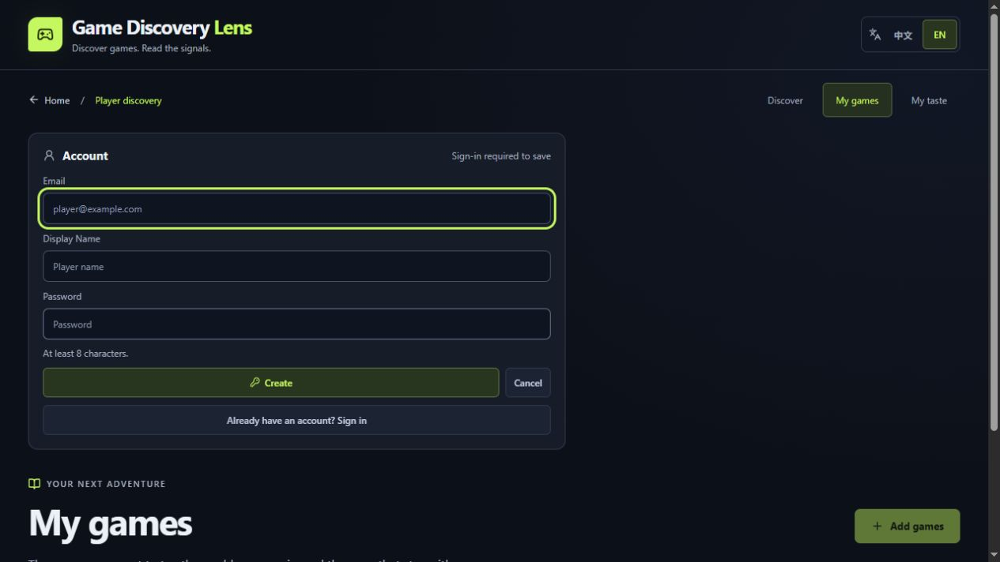
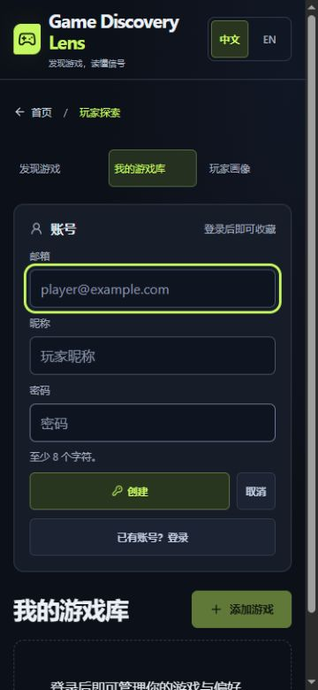
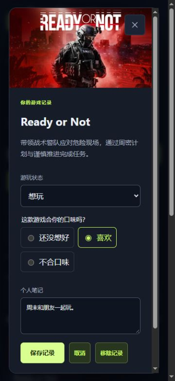

# Registration click fix and portfolio freeze / 注册点击修复与版本收尾

Date: 2026-11-16 (America/New_York). Starting commit: `4448715362384a4b42146dea634b225e9a24a711`; the worktree was clean. This record covers the final account-form correction and documentation, not another feature phase.

**结论：**已复现并修复注册入口偶尔需要点击两次的问题。桌面英文、中文窄屏及真实 API 注册／记录保存／刷新恢复均已复核。README 在一个文件中提供完整中英文说明，交代原小组课程实现、后续现代重建、AI 辅助范围、目录和运行方式。本版本冻结功能开发；既有记录保留原日期与证据范围。

## Reproduced failure and minimal correction

From the player page, choose **Track this game**, leaving the focused sign-in identifier empty, then click **Create Account** once. The new browser regression failed on both desktop and mobile against the starting implementation.

A temporary event/geometry probe on desktop recorded:

| Event | Observed target / geometry |
| --- | --- |
| Before pressing | Create Account button: x=55, y=418.75, width=650, height=38 |
| Mouse down | Create Account button |
| Focus leaves identifier | The empty-field message is inserted |
| After blur | Button y=444.75: it moved down 26 px |
| Mouse up and click | Form, instead of the intended button |

This is a reproduced browser layout/event issue, not an inferred backend registration failure. The probe was removed after diagnosis. The fix removes blur-triggered error insertion in `AccountPanel`: submission shows validation messages and focuses the first invalid input; visible errors continue updating as the user edits. Switching modes and cancelling do not introduce validation layout changes during a click. Existing required fields, length limits, server validation and keyboard submission remain in place.

`frontend/e2e/account-form.spec.ts` uses an actual pointer press/release interval to cover Create Account, returning to Sign In, invalid submission and Cancel. A DOM-only unit click would not reproduce the original pointer/blur/layout sequence.

## Checks executed locally

Windows; Node 24.22.0; Python 3.12.7; PostgreSQL 16 in a disposable local container. Database work used isolated `gdl_e2e_<uuid>` schemas. The local API wrapper explicitly overrode the database URL, schema, authentication secret and AI mode, leaving the main database untouched and disabling paid model calls. Native configuration still follows the application's existing `.env` loader; no configured secret was printed or copied into evidence.

| Check | Result |
| --- | --- |
| New regression before correction | 2 failures: desktop and mobile; focused instrumented desktop run also failed |
| New regression after correction | 2 passed |
| `npm test -- --run` | 310 passed across 27 files |
| `npm run build` | Passed; TypeScript and Vite production bundle |
| `npm audit --audit-level=low` | 0 vulnerabilities |
| Full `npm run test:e2e` with disposable PostgreSQL | 40 passed, 4.0 minutes; includes the 38 existing cases plus 2 account-form cases |

The broader browser regression retains coverage for account isolation, expired sessions, failed/unknown writes, notes, preferences, filtering, navigation state and request reuse. Backend implementation is unchanged in this closure; the previous local 123-test backend result remains in the [November 15 record](delivery-preferences-search-2026-11-15.md), rather than being presented as a newly executed local result. GitHub runs its backend, frontend, browser and packaged-delivery gates for the uploaded revision: [CI runs](https://github.com/ZedekiahS/Game-Discovery-Lens/actions/workflows/ci.yml).

## Computer Use: real API and built frontend

The frontend was built with `VITE_DATA_MODE=api` and the loopback API URL, then served through Vite preview on port 4191. `tests.serve_e2e` ran the real migrated/seeded API on port 8011 in a separate UUID schema. This is production frontend output with a local test API, not a publicly deployed service. The catalog contained 80 games. Desktop used the default 1280 × 720 browser viewport; Chinese narrow-screen verification used 375 × 812, with document width also 375. No network throttling or performance comparison was performed in this fix.

| Task | Actual steps and observed result |
| --- | --- |
| Desktop English, first click | Track this game → empty identifier focused → single Create Account click → registration form visible and email focused |
| Desktop form continuity | Single Already have an account click returns to sign-in; single empty Sign In submit immediately shows both required messages and focuses identifier; single Cancel closes registration |
| Chinese narrow screen | 登录 → empty identifier focused → single 注册账号 click opens registration and focuses email |
| Validation and keyboard | Single empty 创建 click shows email/name/password errors; filling the fields clears those messages; Return from the password field registers successfully |
| Persisted record | Open Ready or Not → set 想玩 and 喜欢 → enter a short Chinese note → 保存记录 shows saved feedback and one library entry |
| Refresh and return | Reload → account and library restored → reopen record → 想玩, 喜欢 and the original note retained |
| Sign out | Account and private library disappear; sign-in controls return |

Server access evidence from this session: one `POST /api/auth/register` → **201**, one `PUT /api/me/games/31` → **200**, then refresh `GET /api/auth/me` and `GET /api/me/games` → **200**. Invalid empty submissions did not send registration requests. The inspected browser console contained no warning/error entries. Test values were synthetic and used an `example.test` address. Temporary services and data are removed after verification.

| Desktop first-click registration | Chinese first-click registration | Persisted record after refresh |
| --- | --- | --- |
|  |  |  |

## Documentation closure

- README provides bilingual summaries plus two complete native `
` language sections in the same file. Language links navigate within the page; headings expand/collapse. This is not a JavaScript language switch, and each language independently includes setup steps. The application's actual language control remains separate.
- The old Java Swing/JDBC/SQL Server implementation is identified as group coursework; the modern React/FastAPI/PostgreSQL application is a scoped reimplementation with AI-assisted development. The maintainer's decisions, review, verification and delivery responsibility are explicit. No unsupported attribution of individual legacy modules was added.
- The directory guide distinguishes modern `backend/alembic/` from historical root `migrations/`, and the earlier static `demo/` from the current React demo. The case study and architecture explain actual changes and boundaries.
- The backend guide now matches existing conditional record writes and `expectedVersion` preference saves. This corrects outdated examples, without changing the API.
- The architecture's modern tag-calibration paragraph was moved out of Legacy Coursework. Migration/status documents end with accepted limits, not an active roadmap.
- The existing review chat supplied documentation advice. Its read-only review of the starting commit is not evidence that it ran this new fix. GitHub supports the chosen disclosures: [official formatting reference](https://docs.github.com/en/get-started/writing-on-github/working-with-advanced-formatting/organizing-information-with-collapsed-sections).

## Freeze and limits

Feature development stops with this portfolio version. No public comments, additional providers, deployment, visual redesign or architecture replacement were added. The fixed catalog, synthetic market metrics, bounded language parser, authored recommendation diagnostics and optional model are disclosed in README. Computer Use here is Chromium desktop/narrow-viewport verification, not physical-phone or all-browser coverage. Closing/reloading a page does not persist an unsaved in-memory draft. No live paid model, real market-data collection or production operations claim is made.
